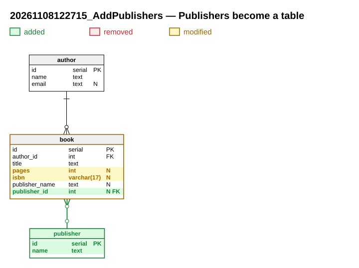

# schema-migrations

A [Claude Code](https://code.claude.com) plugin that prepares database schema migrations as a package you
review like a pull request, **before** anything is applied or coded against it.

You (or Claude) describe the change in a small JSON spec. The plugin generates everything else, in one
folder per migration:

| File | What it is |
|---|---|
| `<id>.up.sql`, `<id>.down.sql` | The migration and its rollback, PostgreSQL. Down mirrors Up, data migration included |
| `model.xml` | The data model after the migration, in the Redgate Data Modeler XML format (formerly Vertabelo), layout included |
| `diff.svg` | The whole schema, with the changes coloured in: green added, red removed, amber modified |
| `schema.svg` | The whole schema after the migration, without colours |
| `<id>.md` | A "what's new" note, in English or French: why, new and modified tables, relations, data migration, compatibility, deployment steps |
| `changes.json` | The spec: the only file you edit. Rebuild as often as the review needs |

Claude then **stops** and asks you to review. It applies the migration and writes the code that depends on
it only once you agree.



See the [example project](examples/library/migrations): three migrations of a small library schema, with
their [what's new notes](examples/library/migrations/20261108122715_AddPublishers/20261108122715_AddPublishers.md).

## Install

In Claude Code:

```
/plugin marketplace add nletullier/schema-migrations
/plugin install schema-migrations@nletullier
```

or from a shell:

```bash
claude plugin marketplace add nletullier/schema-migrations
claude plugin install schema-migrations@nletullier
```

To make it available to everyone working on a repository, run the first command with `--scope project`
and commit `.claude/settings.json`.

Requirements: Python 3.10 or later (standard library only). Generated SQL targets PostgreSQL.

## Use

Ask for a feature that needs a schema change, or say *"prepare a migration that adds invoices"*. The skill
also triggers on its own when a task needs a new table, column, index, constraint or foreign key.

The first time in a project, Claude asks where migrations live, how they are created (your own command, or
none) and whether you have a Redgate export of the current schema to start from. It writes
`.schema-migrations.json` at the root of the project:

```json
{
  "language": "en",
  "dialect": "postgresql",
  "baseline": "db/migrations/baseline.xml",
  "migrations": {
    "dir": "db/migrations",
    "create": null,
    "up": "{id}.up.sql",
    "down": "{id}.down.sql"
  }
}
```

- `create` is an optional command that creates the migration (for instance `./add-migration.sh {name}` for
  an EF Core project); it must leave the folder `<dir>/<timestamp>_<Name>/` with the Up/Down files in it.
  Without it, the plugin creates them itself.
- `baseline` is the model the first migration starts from. If you have none, an empty one is created.
  Every later migration starts from the previous one's `model.xml`.

The workflow, which you can also run by hand:

```bash
S=<plugin>/skills/schema-migrations/scripts
python3 -I $S/prepare_migration.py init --dir db/migrations   # optional: --baseline export.xml
python3 -I $S/prepare_migration.py new AddInvoices     # migration folder, Up/Down files, spec skeleton
# edit db/migrations/<timestamp>_AddInvoices/changes.json
python3 -I $S/prepare_migration.py build AddInvoices   # SQL, model.xml, diagrams, what's new
```

The spec format is documented in
[`references/spec-format.md`](skills/schema-migrations/references/spec-format.md), with
[complete examples](skills/schema-migrations/references/examples).

## What it does well, and what it does not

- Additions, alterations (type, nullability, default, checks, renames), drops, indexes (unique, partial),
  unique keys, checks and foreign keys with their `ON DELETE` rules.
- Data migrations at the right moment: `data.before` runs before any structural change; `data.up` after
  the additions and before the removals, so it can read a column the migration drops.
- Columns are matched by identity, so a rename is a `RENAME COLUMN`, not a drop and an add.
- The Redgate XML is written back byte for byte: an untouched model loads and saves identically, so diffs
  in your repository only show real changes. You can still open the model in Redgate Data Modeler.
- New tables are placed near the table you name (`near`), on free space covering as few existing lines as
  possible; new relation lines avoid tables when they can. It is a heuristic, not Redgate's own layout.
- Only PostgreSQL SQL is generated. Views, sequences, functions and triggers are not modelled: write them
  as raw SQL in the data steps.
- Tables cannot be renamed through the spec.

## Tests

```bash
python3 -m unittest discover -s tests
```

## Licence

MIT. See [LICENSE](LICENSE).
