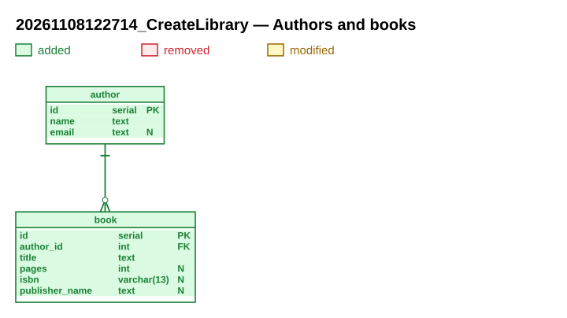

# Authors and books

**Migration**: `20261108122714_CreateLibrary` · **Date**: 2026-11-08

The first tables of the library catalogue: authors and their books.

## Why

We start cataloguing the library. A book has one author; an author can have many books.

## At a glance

- 2 tables created
- 1 relation added

## What changes

## New tables

### `author`

People who write books.

| Column | Type | Null | Default | Purpose |
|---|---|---|---|---|
| `id` | `serial` | no |  | Identifier. |
| `name` | `text` | no |  | Full name, as printed on the cover. |
| `email` | `text` | yes |  | Contact address, if known. |

- Primary key: `id`
- Unique keys: `author_email_uk` (email)

### `book`

Books of the catalogue.

| Column | Type | Null | Default | Purpose |
|---|---|---|---|---|
| `id` | `serial` | no |  | Identifier. |
| `author_id` | `int` | no |  | Author of the book. |
| `title` | `text` | no |  | Title. |
| `pages` | `int` | yes |  | Number of pages. Check: `pages > 0` |
| `isbn` | `varchar(13)` | yes |  | ISBN-13, digits only. |
| `publisher_name` | `text` | yes |  | Publisher, typed by hand. |

- Primary key: `id`
- Indexes: `ix_book_author` (author_id, title)
- Constraints: `book_title_ck` `char_length(title) > 0` (A title is never empty.)

## Relations

| Relation | From | To | ON DELETE | Status |
|---|---|---|---|---|
| `book_author` | `book.author_id` | `author.id` | CASCADE | added |

## Deployment

Apply the migration. The tables are empty: nothing else to do.

## Files

- Up script: [20261108122714_CreateLibrary.up.sql](20261108122714_CreateLibrary.up.sql)
- Down script: [20261108122714_CreateLibrary.down.sql](20261108122714_CreateLibrary.down.sql)
- Data model: [model.xml](model.xml)
- Full schema after the migration: [schema.svg](schema.svg)
