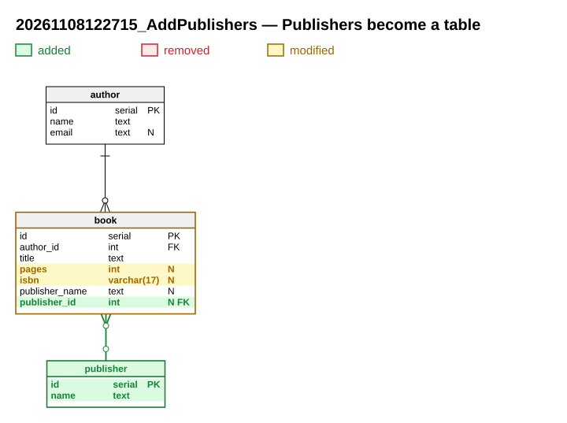

# Publishers become a table

**Migration**: `20261108122715_AddPublishers` · **Date**: 2026-11-08

Publishers get their own table, and each book points to its publisher instead of a hand-typed name.

## Why

The same publisher was typed in many ways (« Gallimard », « gallimard », « Gallimard  »). A table gives one row per publisher, and books can be listed by publisher.

## At a glance

- 1 table created
- 1 table modified
- 1 relation added

## What changes



## New tables

### `publisher`

Publishing houses.

| Column | Type | Null | Default | Purpose |
|---|---|---|---|---|
| `id` | `serial` | no |  | Identifier. |
| `name` | `text` | no |  | Name of the house. |

- Primary key: `id`
- Unique keys: `publisher_name_uk` (name)

## Modified tables

### `book`

- Column added: `publisher_id` `int`, NULL — Publisher of the book.
- Column modified: `pages`, CHECK `pages > 0` → `pages > 0 AND pages < 20000`
- Column modified: `isbn`, `varchar(13)` → `varchar(17)`
- Index added: `ux_book_isbn` (isbn), unique, where `isbn IS NOT NULL`

## Relations

| Relation | From | To | ON DELETE | Status |
|---|---|---|---|---|
| `book_publisher` | `book.publisher_id` | `publisher.id` | SET NULL | added |

## Data migration

One publisher is created per distinct name already typed (spaces trimmed), and each book is linked to it. Running it again creates nothing new.

```sql
INSERT INTO publisher (name)
SELECT DISTINCT btrim(publisher_name) FROM book
WHERE publisher_name IS NOT NULL AND btrim(publisher_name) <> ''
ON CONFLICT (name) DO NOTHING;

UPDATE book b SET publisher_id = p.id
FROM publisher p
WHERE p.name = btrim(b.publisher_name) AND b.publisher_id IS NULL;
```

## Compatibility

`book.publisher_name` stays in place and is still filled by the current version of the application, which does not know `publisher_id` yet. Nothing breaks during the deployment.

## Deployment

1. Apply the migration: it creates the publishers from the names already typed and links the books.
2. Deploy the application that writes `publisher_id`.

## Deferred removals and follow-ups

`book.publisher_name` is dropped by a later migration, once no running version writes it any more (see `DropPublisherName`).

## Files

- Up script: [20261108122715_AddPublishers.up.sql](20261108122715_AddPublishers.up.sql)
- Down script: [20261108122715_AddPublishers.down.sql](20261108122715_AddPublishers.down.sql)
- Data model: [model.xml](model.xml)
- Full schema after the migration: [schema.svg](schema.svg)
