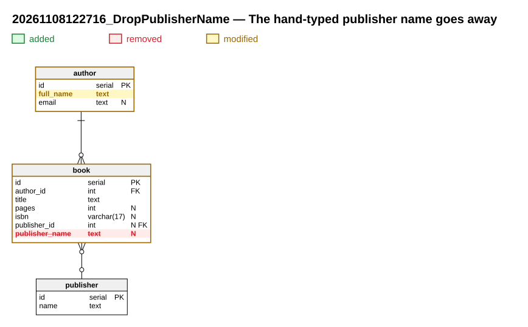

# The hand-typed publisher name goes away

**Migration**: `20261108122716_DropPublisherName` · **Date**: 2026-11-08

Second step of `AddPublishers`: `book.publisher_name` is dropped, and the author's `name` becomes `full_name`.

## Why

Every running version of the application now writes `book.publisher_id`; the old column is dead weight.

## At a glance

- 2 tables modified

## What changes

## Modified tables

### `author`

- Column renamed: `name` → `full_name`

### `book`

- Column dropped: `publisher_name` `text`

## Data migration

Down puts the publisher's name back in `book.publisher_name` for the books that have one.

## Compatibility

Only deploy once the versions that wrote `publisher_name` are all stopped. The application must read `author.full_name` from this release on.

## Deployment

1. Check that no running instance still writes `book.publisher_name`.
2. Apply the migration and deploy the application in the same release.

## Files

- Up script: [20261108122716_DropPublisherName.up.sql](20261108122716_DropPublisherName.up.sql)
- Down script: [20261108122716_DropPublisherName.down.sql](20261108122716_DropPublisherName.down.sql)
- Data model: [model.xml](model.xml)
- Full schema after the migration: [schema.svg](schema.svg)
